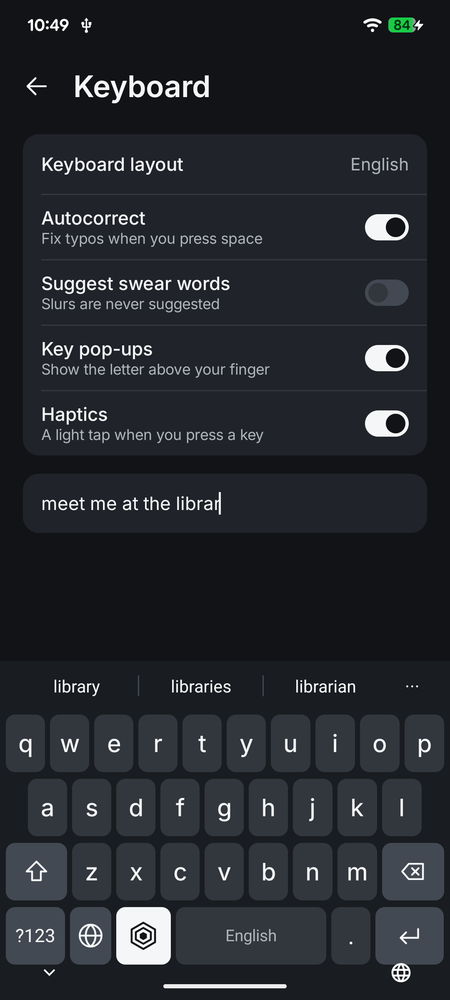
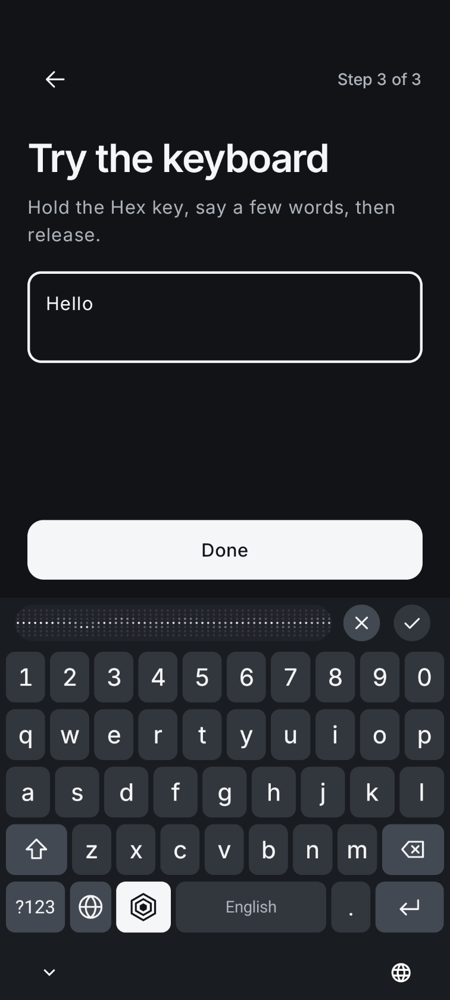
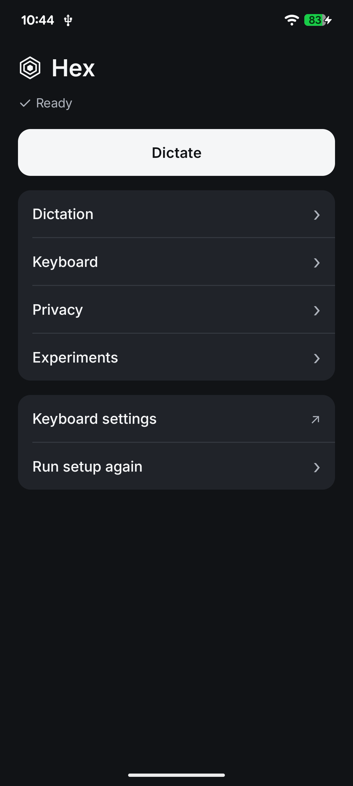
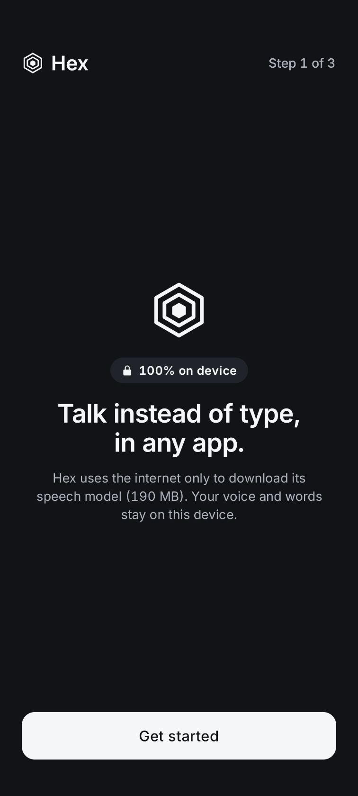

# Hex for Android

[](https://github.com/Shripad735/hex/actions/workflows/android-vtt.yml)

Hold the Hex key, speak, release — your words land in any app. A system-wide
voice keyboard for Android that is **fully offline**: voice never leaves the
phone, no account, no ads, no history.

**Download:** [latest APK](https://github.com/Shripad735/hex/releases/tag/android-vtt-latest)
(debug-signed preview, rebuilt on every push — requires Android 12+ on ARM64).

| Typing with suggestions | Live dictation | Ready home | Welcome |
| --- | --- | --- | --- |
|  |  |  |  |

## How it works

- **Hold** the Hex key, speak, release to insert at the cursor; tap for hands-free dictation, ✕ discards with nothing pasted
- Speech is transcribed **on the phone** by whisper.cpp: Tiny is bundled and works from first launch in airplane mode; one fixed 190 MB Small download (size + SHA-256 verified) gives the best accuracy
- Switching editors or hiding the keyboard cancels in-flight dictation; password fields get typing only — no suggestions, no mic
- A **Speech model picker** (Tiny / Small, Automatic by default) and a **Size setting** (Short → Extra tall) adapt it to any phone

## Features

- Dictation in English, Spanish, German and Norwegian, with Polished, Casual, Notes and Verbatim styles, plus optional Spanish→English translation
- Full keyboard: number row, layouts, autocorrect, spatial decoder, accents, key pop-ups and haptics
- In-app **About** page: source link, developer credit, and an on-demand update check with an update dot on the Home row when a newer build is published
- Private by construction: microphone audio lives in RAM and is never saved; no keystrokes, transcripts, telemetry or accounts; the manifest requests only `RECORD_AUDIO` + `INTERNET` (the one model download and the opt-in update check)

## Build from source

Windows, macOS or Linux with JDK 21 and the Android cmdline tools:

```sh
export JAVA_HOME=<jdk-21> ANDROID_HOME=~/Android/Sdk
sdkmanager "platforms;android-36" "build-tools;36.0.0" "ndk;27.2.12479018" "cmake;3.22.1"
cd android && ./gradlew assembleDebug test
adb install -r app/build/outputs/apk/debug/app-debug.apk
```

76 JVM unit tests; device-verified on a Redmi Note 9 Pro Max (dictation, insertion,
cancel, password lock-down, airplane mode, memory footprint). Plan and results:
[docs/plans/android-vtt-v1.md](docs/plans/android-vtt-v1.md).

## About

Built by **Sripad SK** — [shripadkhandare.in](https://shripadkhandare.in) — who wanted
his own phone to take dictation without sending his voice to a server. Source:
[github.com/Shripad735/hex](https://github.com/Shripad735/hex)
(`android-vtt` branch). The About page in the app links the source, shows the
build version, and checks for updates (on demand, plus one silent check a day).
Suggestions live in
[issues](https://github.com/Shripad735/hex/issues) for now; pull requests that
create suggestions automatically are a later step.

## Upstream

This is a fork of [anomalyco/hex](https://github.com/anomalyco/hex), the local
voice-dictation desktop app for Mac, Windows and Linux. Desktop docs, Labs,
Meetings and the rest live upstream and are untouched here.

MIT licensed.
